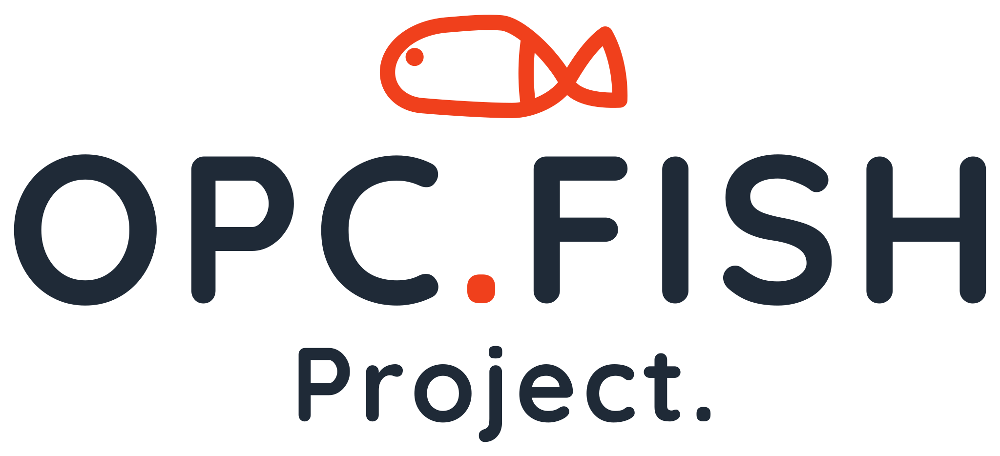

<p align="center">
<a href="https://opc.fish" title="OPC.FISH Project."><picture><source media="(prefers-color-scheme: dark)" srcset="https://raw.githubusercontent.com/YE4IM/readme/main/project/assets/opc-fish-project-signature-web-dark.svg"></picture></a>
</p>

# readme

[**English**](./README.md) | [中文](./README-zh-CN.md)

Writing guides and bilingual Markdown templates for agents preparing GitHub project READMEs, release notes, and changelogs.

[](./LICENSE)

[Go to Quick Start](#quick-start)

## Overview

Choose a guide for what you want to publish. You can read the guides and templates on GitHub or in a local checkout. No installation is required.

The README guide and templates apply to every GitHub project maintained by this repository’s owner, including projects under a personal account. Put the OPC.FISH project signature before the title in every README. Third-party projects follow their own attribution rules.

| Deliverable | Writing guide | Templates |
| --- | --- | --- |
| Project introduction in `README.md` and `README-zh-CN.md` | [Project README guide](./project/project-agent-instructions.md) | [English](./project/templates/readme-template.md) · [中文](./project/templates/readme-zh-CN-template.md) |
| A single bilingual description for one GitHub Release | [Release notes guide](./releases/release-agent-instructions.md) | [Bilingual release template](./releases/release-template.md) |
| A project-wide changelog with version entries | [Changelog guide](./changelog/changelog-agent-instructions.md) | [English](./changelog/changelog-version-template.md) · [中文](./changelog/changelog-version-zh-CN-template.md) |

## Quick Start

1. Open the guide for your deliverable and share it with an agent that can read the target repository.
2. Ask the agent to verify the project facts, use the matching template, and remove unused sections.
3. Save a project README as `README.md` and `README-zh-CN.md`, paste a single bilingual release note into GitHub Releases, or add the version entry to your project changelog.

See the finished project README examples for the expected layout. [English](./project/docs/project.md) · [中文](./project/docs/project-zh-CN.md)

For a GitHub Release, verify the target tag or commit and the comparison range on the same release line. Use the verified release identifier as the GitHub title unless the project has an established title convention. Start the body with a summary, then write the English and Chinese sections in that order, separated by a standalone `---`. Include the pre-release warning in both languages when applicable. [Stable patch](./releases/examples/patch.md) · [Initial release](./releases/examples/initial.md)

The CHANGELOG examples show an unreleased entry, a maintenance-line patch, and an initial release. [English](./changelog/examples/CHANGELOG.md) · [中文](./changelog/examples/CHANGELOG-zh-CN.md)

The same set of releases illustrates which baseline to use for the stable Release and for a changelog that records RCs individually. [Stable Release](./releases/examples/stable-after-rc.md) · [English CHANGELOG](./changelog/examples/CHANGELOG-rc-history.md) · [中文 CHANGELOG](./changelog/examples/CHANGELOG-rc-history-zh-CN.md)

## Checks

Run these commands from the repository root. They need Python 3.8 or later and no packages.

### Project README

```bash
python3 project/scripts/check-readme.py all
python3 project/scripts/test-readme-checks.py
python3 project/scripts/check-readme.py pair /path/to/README.md /path/to/README-zh-CN.md --signature remote
```

The first two commands check the templates and bundled README pairs, then run the regression tests. For your own pair, use `--signature remote` for the shared images or `--signature local` for copies in the target repository. Add `--draft` to allow editorial TODOs. The checker compares Installation and Quick Start commands and checks relative links, anchors, template residue, common secret patterns, the required row of 1–4 matching badges, the signature and folded core steps. Verify project facts, commands and rendered layout. Check that reference-style links such as `[guide][install]` have definitions. For targeted edits, run the same check before and after and report existing failures separately.

### Release notes

```bash
python3 releases/scripts/test-release-templates.py
python3 releases/scripts/check-release-docs.py release /path/to/release.md
```

The test renders the Release template against its fixtures. The checker requires Breaking Changes before Highlights and other change categories and compares the category set, item counts, visible alerts, issue references, contributor handles, and recognizable shared download or comparison links. It also compares images in Highlights. It does not enforce the full Added, Fixed, or Security order.

Add `--prerelease` to check for a warning after each language’s summary. Use `--draft` for editorial TODOs while facts or required upgrade steps are pending, and rerun the check without that flag for final copy. Review custom category translations, localized guides, bare PR URLs, commands and factual equivalence against the release evidence. Direct download links, including recognizable extensionless installers, must point to the same asset. Record copy readiness and publication status in the handoff.

### Changelog

```bash
python3 changelog/scripts/test-changelog-templates.py
python3 changelog/scripts/check-release-docs.py changelog /path/to/CHANGELOG.md /path/to/CHANGELOG-zh-CN.md
```

Pass one path for a single-language changelog. For one file containing both languages separated by a standalone `---`, add `--bilingual`; a bilingual changelog in one file shares one set of Markdown reference definitions across languages, so define a reused version link once. Add `--draft` to allow editorial TODOs, including a publication-date TODO that is still unverified.

The checker applies the same category, alert, contributor-handle, and shared-link comparison as the Release checker, and does not enforce the full Added, Fixed, or Security order. Published entries support dash or parenthesized ISO dates, with an optional label such as `Pre-release` after the date, in newest-first order with ties allowed; a changelog that groups versions by release line instead of global publication date fails that check. An explicit pre-release label requires a warning even for a custom version identifier. Both languages must agree on release status. Keep `Unreleased` undated.

Verify version headings, migration steps and dates against the repository. For targeted updates, report the new entry’s result and the whole file’s result separately. Before publication, record copy readiness separately from publication status.

## License

[MIT License](./LICENSE).
